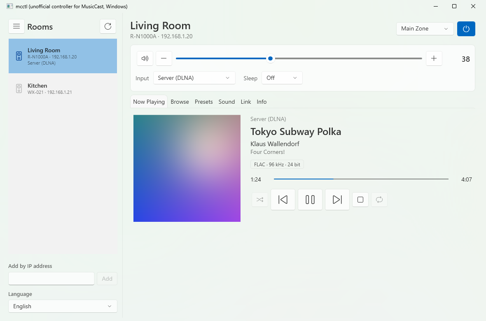
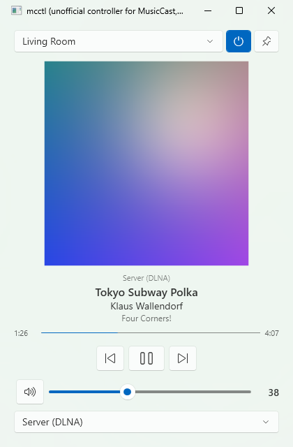

**English** | [日本語](README.ja.md)

# mcctl (unofficial controller for MusicCast, Windows)

**mcctl** is an unofficial Windows controller for Yamaha MusicCast–compatible devices (speakers, AV receivers, sound bars, network players).

Repository: <https://github.com/mimura1133/mcctl>

> mcctl is an independent project and is not affiliated with, endorsed by or sponsored by Yamaha Corporation.
> Yamaha and MusicCast are trademarks or registered trademarks of Yamaha Corporation.

## Screenshots

<p>
  
  
</p>

Main window (left) and the mini player shown when the window is small (right). Screenshots use sample data.

## Project layout

```
Mcctl.slnx
├─ src/Mcctl.Core   … protocol library (net11.0, no external packages)
├─ src/Mcctl.App    … Windows GUI, mcctl-gui.exe (WPF, Fluent theme, English / Japanese)
├─ src/Mcctl.Cli    … command-line tool mcctl.exe (for debugging and scripting)
├─ tests/Mcctl.Core.Tests … xUnit tests (fake HTTP device)
├─ docs/library.md … how to use the Mcctl.Core library
└─ tools/gen_resx.py … generates the UI string resources from strings.tsv
```

## Build

```bash
git clone https://github.com/mimura1133/mcctl.git
cd mcctl
dotnet build src/Mcctl.App -c Release
```

Output: `src/Mcctl.App/bin/Release/net11.0-windows/mcctl-gui.exe`

Tests require fetching NuGet packages, so run them in a disposable container:

```bash
docker run --rm -v "%CD%:/src:ro" mcr.microsoft.com/dotnet/sdk:11.0 bash -c "cp -r /src /w && cd /w && dotnet test tests/Mcctl.Core.Tests"
```

## Features (GUI)

| Area | What you can do |
|---|---|
| Rooms | Auto-discovery over SSDP, manual add by IP, power state shown in the list, collapsible room pane |
| Basic controls | Power on/standby, volume (slider and ±), mute, input switching (inputs in ABC order), sound program, sleep timer, zone switching (main/zone2…) |
| Now Playing | Track, artist, album, artwork (fitted, never cropped), audio format (e.g. "MP3 · 44.1 kHz"), elapsed time, play/pause/previous/next/stop, shuffle/repeat, CD tray |
| Browse | Navigate the folder hierarchy of Net Radio, servers (DLNA), USB, radiko, streaming services and so on, play items, and run searches (e.g. Net Radio → Radio → Search) |
| Presets | Recall and store network favorites, recall recently played items, recall tuner presets |
| Tuner | Switch AM/FM/DAB, step tuning, auto seek, direct tuning, step through presets |
| Sound | Bass/treble, toggle Pure Direct, Enhancer, Clear Voice, Bass Extension and similar features |
| Link | MusicCast Link (multi-room): link other rooms to this one, unlink, dissolve the group |
| Mini player | Below 720 × 480 the window turns into a compact player (artwork, track, transport, volume, input, always-on-top) |
| Language | English / Japanese, switchable at runtime from the room pane ("System" follows the Windows display language) |
| Live updates | Receives UDP push notifications (changes show within a fraction of a second), with 5-second polling as a fallback |

Settings are stored in `%APPDATA%\mcctl\`: `hosts.json` (rooms you added by IP) and `settings.json` (UI language).

### UI strings

UI text lives in `src/Mcctl.App/Localization/strings.tsv` (key, Japanese, English). After editing it, regenerate the resources (requires Python 3):

```bash
python tools/gen_resx.py src/Mcctl.App/Localization
```

## Using the library

To control devices from C# with the Mcctl.Core library, see [docs/library.md](docs/library.md).

## CLI (mcctl)

```
mcctl discover [--verbose]
mcctl status 192.168.1.20
mcctl volume 192.168.1.20 25
mcctl input 192.168.1.20 spotify
mcctl list 192.168.1.20 --input net_radio
mcctl select 192.168.1.20 0 --input net_radio
mcctl search 192.168.1.20 1 jazz --input net_radio
mcctl link 192.168.1.20 192.168.1.21
mcctl events 192.168.1.20
mcctl raw 192.168.1.20 "netusb/getRecentInfo"
mcctl raw 192.168.1.20 netusb/setSearchString "{\"string\":\"jazz\"}"
```

## Not implemented / limitations
- Signing in to streaming service accounts (Spotify and similar services work as Connect targets from their own apps)
- Initial network setup of a device (Wi-Fi setup, firmware updates), alarm and clock settings, editing playlists and the play queue
- Tested on a Yamaha R-N1000A (discovery, status, browsing Server / Net Radio / radiko, search, artwork, audio format).
- The following are untested:
  - MusicCast Link
  - Sound features (tone control, Pure Direct, Enhancer and other switches)
  - CD playback on devices with a built-in CD drive (track info, playback controls, tray)
  - Storing and recalling presets
  - Sleep timer

## License

[MIT License](LICENSE). The license does not grant any rights to Yamaha's trademarks.
